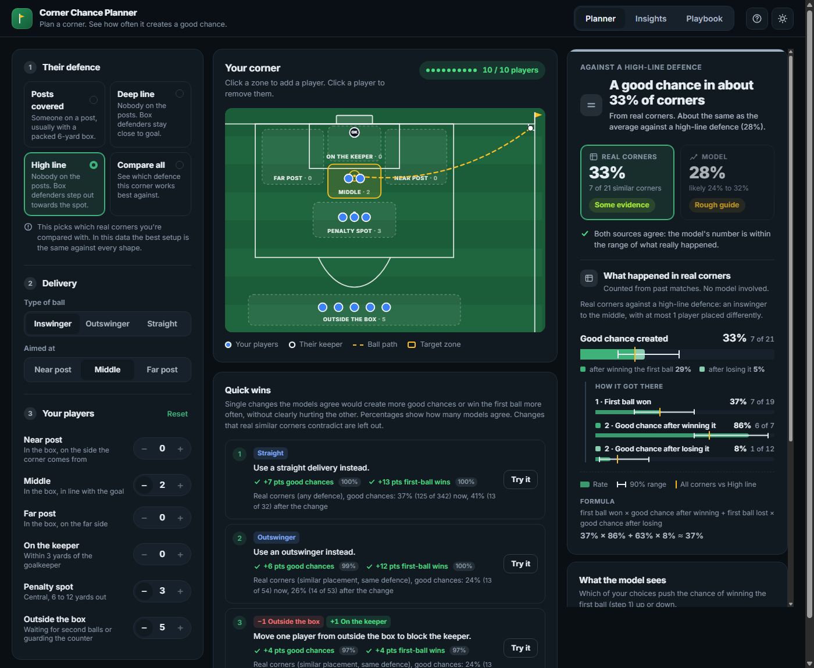
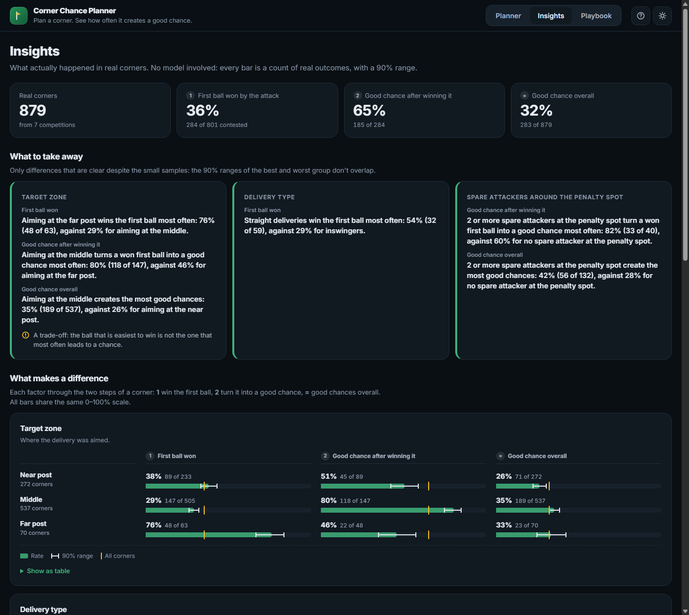
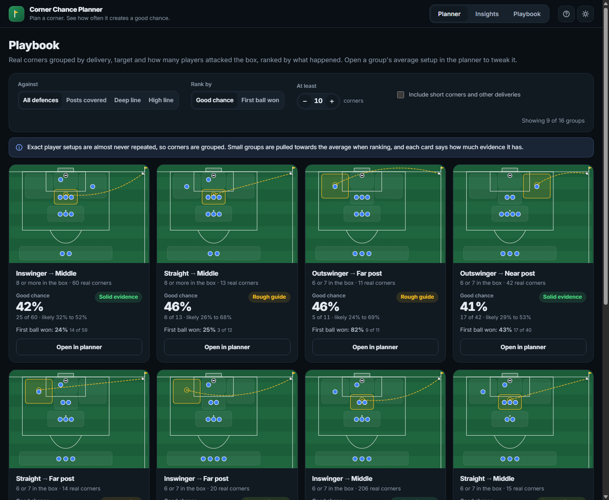

# Corner Chance Planner

**Which attacking corner setups actually create chances?** A data-driven planning tool for football coaches, built on 879 real corners from StatsBomb 360 data.

Pick the delivery, the target zone and where your players stand. The tool shows how often similar real corners won the first ball and created a good chance, alongside a model estimate tested on competitions it never saw.



## Key findings

- **A corner is a two-step chain.** Only about 1 in 3 first balls are won, but about 2 in 3 of those become a good chance. Losing the first ball drops that to fewer than 1 in 5.
- **Target zone is a trade-off.** Far-post balls are won most often (76%), but won balls in the middle turn into chances far more often (80% vs 46%). Overall, the middle creates the most good chances.
- **Spare attackers near the penalty spot matter.** With 2 or more spare attackers there, 42% of corners create a good chance, against 28% with none.
- **The opponent's defensive shape makes no clear difference** once competition is accounted for. Counter-attack risk (about 5% of corners) can't be predicted from the setup, so the tool doesn't pretend to.

## Highlights

- **Honest evaluation.** Every model is tested leave-one-competition-out: train on six competitions, predict the seventh. Predicting the first ball reaches AUC 0.68 on unseen competitions, and models are calibrated.
- **Evidence first.** The app leads with real past corners (with a 90% range) and shows the model as a second opinion, labelled by how reliable it is.
- **Rebuilt after finding a flaw in my own work.** The original version (v1) reported scores measured on its training data. Re-tested properly, it was no better than a coin flip, so I redesigned the targets, features and evaluation from scratch. See [Version history](#version-history).

**Tech stack:** Python, pandas, scikit-learn (logistic regression, bootstrap ensembles), SHAP, FastAPI, HTML/CSS/JavaScript, Jupyter.

## How it measures a corner

1. **First ball won**: an attacker plays the ball first after the delivery, rather than a defender or the keeper.
2. **Good chance**: a shot worth at least 0.04 xG while the attacking team keeps the ball, within 60 seconds.

```
good chance = first ball won × good chance after winning it
            + first ball lost × good chance after losing it
```

How well each step is predicted on competitions the model never saw (0.5 = coin flip):

| Step | AUC | Label in the app |
|---|---|---|
| First ball won | 0.68 | Tested |
| Good chance after winning it | 0.68 | Tested |
| Good chance after losing it | 0.58 | Weak |
| Good chance overall | 0.57 | Rough guide |

Expected goals for and against (APV = xG created − xG conceded) are kept as a secondary analyst view.

## The app

| Planner | Insights | Playbook |
|---|---|---|
| Set up a corner and compare **real corners** (similar past corners, with a 90% range) with **the model** (an estimate for your exact setup). Quick wins suggest single changes that the models agree help and real corners don't contradict. | What actually happened in real corners, step by step: target zone, delivery type, spare attackers, and the factors that make little difference. | Groups of real corners (delivery, target, players in the box), ranked by good chances. Each opens its average setup in the planner. |

<p>
  
  
</p>

### Stakeholder notebook

[`notebooks/corner_chances_overview.ipynb`](notebooks/corner_chances_overview.ipynb) explains the findings and the tool for non-technical readers. It is saved with all its tables and charts, so it reads on GitHub without running anything.

## Running it

Python 3.12.

```bash
pip install -r requirements.txt

# start the web app, then open http://127.0.0.1:7860
python app.py
```

The trained models and app files (`models/`, `artefacts/`, `outputs/`) are included, so the app works straight away. To use another port: `PORT=7862 python app.py` (bash) or `$env:PORT=7862; python app.py` (PowerShell).

To retrain (needs the StatsBomb data in `Statsbomb/`):

```bash
# full pipeline: load data, build features and labels, train and evaluate (several minutes)
python train.py

# retrain from the saved corner table only, after changing model settings
python train.py --models-only

# rebuild the stakeholder notebook after retraining
python notebooks/build_overview.py
```

## Data

[StatsBomb open data](https://github.com/statsbomb/open-data) with 360 freeze frames: 879 corners from 306 matches in 7 competitions (World Cup 2022, Euro 2020 and 2024, Women's World Cup 2023, Women's Euro 2022 and 2025, Bundesliga 2023/24, Ligue 1 2021/22 and 2022/23, La Liga 2020/21). Used under the StatsBomb [user agreement](https://github.com/statsbomb/open-data/blob/master/LICENSE.pdf).

## Limitations

- **Sample size**: 879 corners. Exact setups are almost never repeated, and most teams defend only a handful of corners, so opponent-specific advice isn't possible yet.
- **Freeze frames**: one snapshot at the moment of the corner. It shows positions, not runs or marking, and doesn't identify players.
- **Competitions**: all women's data comes from international tournaments. Women's corners create more good chances (43% vs 28%), mostly after the first ball is lost.
- **Excluded**: MLS 2023 (its freeze frames show too few players) and the African Cup of Nations 2023 (almost no 360 data).

**Next steps** that would improve it: more corners (more seasons or a club's own matches), tracking data to capture runs and marking, and player identities for matchup-level advice.

## Project layout

```
config.yaml           data paths, competitions, model and app settings
train.py              pipeline: stages 1-8
app.py                FastAPI server for the web app
src/
  io_sb.py            loading StatsBomb files
  preprocess.py       events, corners, 360 frame quality filter
  feat_eng.py         attacker and defender counts per zone, delivery features
  clustering.py       rule-based defensive shapes (k-means kept as a benchmark)
  target_eng.py       first-contact and possession-phase outcome labels
  models.py           models, grouped and leave-one-competition-out evaluation, bootstrap
  apv.py              expected-goals APV
  insights.py         app files: corner outcomes, defaults, explanations
  apv_engine.py       scoring a setup against real situations
  coach_service.py    what the app shows: evidence, estimates, quick wins, playbook, insights
web/                  the front end (HTML, CSS, JavaScript)
notebooks/            stakeholder overview notebook

produced by train.py:
models/               trained models and the bootstrap ensemble, loaded by the app
artefacts/            corner outcomes, defaults and explanation data, loaded by the app
outputs/
  train/              corner table and APV tables, reused by --models-only and the notebook
  model_importance/   SHAP feature importance per model
  reports/train/      evaluation tables and figures
```

### Evaluation reports

`outputs/reports/train/` after a full run:

- `model_evaluation_train.csv`: every model against the base rate and a shape-only model, on unseen matches and unseen competitions
- `model_per_competition_train.csv`: results for each held-out competition
- `model_horizon_sensitivity_train.csv`: 30, 60 and 90 second windows
- `cluster_eval_train.csv`: rule-based defensive shapes against k-means
- `first_contact_labels_check.csv`: a sample of first-contact labels with the events behind them, for checking by hand

## Version history

- **v2 – Corner Chance Planner (current).** Rebuilt around the two-step chain (first ball won, then a good chance), with an evidence-first web app, a stakeholder notebook, and every model tested on competitions it never saw.
- **v1 – Corner APV Coach** (tag [`v1-original`](https://github.com/MSyukri420/final-project-apv/tree/v1-original)). The original final-year project: a Gradio app scoring corners by APV (chance probability minus shot-conceded probability). Its reported scores (AUC 0.61 for chances, 0.75 for shots conceded) were measured on its own training data. Re-tested on unseen competitions, it did no better than a coin flip and its probabilities were badly inflated (42% predicted chance of conceding a shot vs a real rate of 5%). Finding this led to the v2 rebuild.
